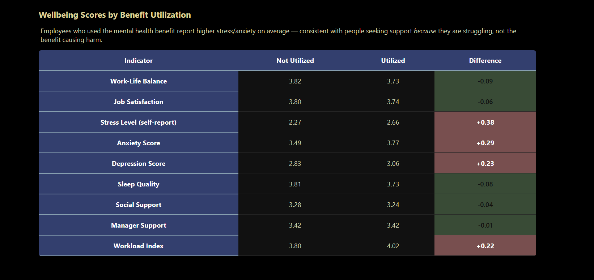
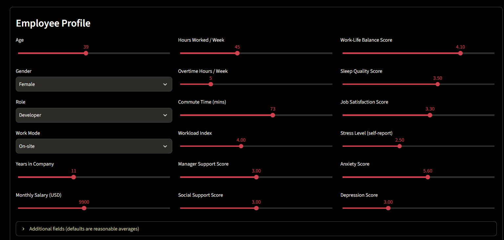
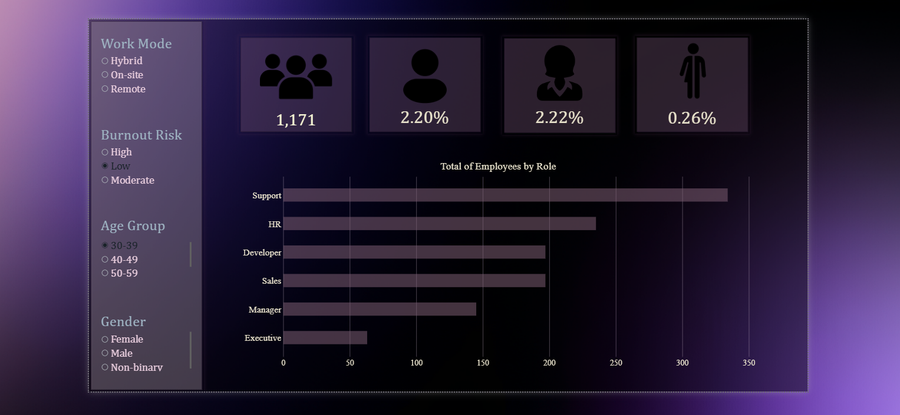

# 🤖 Burnout Risk Prediction Project

A Random Forest classifier that predicts employee **burnout risk** (Low / Moderate / High) from workplace and personal wellbeing indicators, paired with an interactive Streamlit app and a Power BI dashboard.

---

## 📌 Overview


This project walks through a full data analytics pipeline:

1. **Data cleaning & understanding** — exploring and preparing the raw employee dataset
2. **Exploratory Data Analysis (EDA)** — understanding what drives burnout risk
3. **Predictive modeling** — a Random Forest classifier trained to predict `burnout_risk`
4. **Interactive app** — a Streamlit app where a user enters employee data and gets a predicted burnout risk
5. **Dashboard** — a Power BI dashboard summarizing key HR analytics insights

---

## 🧠 The Prediction Model



| | |
|---|---|
| **Model** | Random Forest (200 trees) |
| **Train / Test Split** | 80% / 20% |
| **Overall Accuracy (default)** | 69.4% |
| **Overall Accuracy (custom thresholds)** | 48.5% |

### Why Custom Thresholds Were Needed

`burnout_risk` is an imbalanced target (Moderate = 66%, Low = 18%, High = 16%). With default predictions, the model correctly identified only **56%** of real High-risk employees — it defaulted to predicting "Moderate" too often.

Since missing a real High-risk employee is costlier than a false alarm, **custom decision thresholds** were applied: an employee is flagged **High** if `P(High)` exceeds a threshold, even when High isn't the single most likely class.

### Role-Based Thresholds

Manager and Executive roles have the highest actual High-risk rates in the dataset (25.7% and 20.3% respectively, vs. 11–17% for other roles), so they use a more sensitive threshold:

- **Manager / Executive:** `P(High) ≥ 0.20`
- **Other roles:** `P(High) ≥ 0.25`

### Performance — Default vs. Custom Thresholds

**Default predictions:**

| Class | Precision | Recall | F1-score | Support |
|---|---|---|---|---|
| Low | 0.54 | 0.56 | 0.55 | 900 |
| Moderate | 0.77 | 0.76 | 0.77 | 3300 |
| High | 0.55 | 0.56 | 0.56 | 800 |

**Role-based custom thresholds:**

| Class | Precision | Recall | F1-score | Support |
|---|---|---|---|---|
| Low | 0.40 | 0.82 | 0.54 | 900 |
| Moderate | 0.82 | 0.30 | 0.44 | 3300 |
| High | 0.35 | 0.87 | 0.50 | 800 |

**Key takeaway:** High-risk recall improved from **56% → 87%** using custom thresholds — meaning far fewer truly at-risk employees are missed. This comes at a cost: High-risk precision drops to 35% (more false alarms) and Moderate recall drops to 30%, and overall accuracy falls from 69.4% to 48.5%. This trade-off is intentional — for an HR early-warning use case, catching more true High-risk employees is prioritized over minimizing false positives.

### Top Features Driving Burnout Risk

1. Stress Level (self-report) — 0.137
2. Workload Index — 0.110
3. Hours Worked per Week — 0.097
4. Work-Life Balance — 0.063
5. Anxiety Score — 0.054
6. Sleep Quality — 0.047
7. Monthly Salary — 0.042
8. Depression Score — 0.042
9. Manager Support — 0.040
10. Overtime (hrs/week) — 0.040

*(see the full report for the complete top-15 list)*

---

## 📂 Repository Structure

```
Burnout-Project/
├── Classes/                              # Supporting Python classes/modules
├── Dataset/                              # Employee dataset used for the project
├── Read this before doing anything/      # Setup notes
├── Report/                               # Generated analysis report(s)
├── Burnout prediction model.py           # Trains the Random Forest model
├── streamlit_app.py                      # Interactive Streamlit app
├── Full Report.py                        # Generates the full HTML analysis report
├── Understanding and Cleaning Data.ipynb # Data cleaning notebook
├── EDA.ipynb                             # Exploratory Data Analysis notebook
├── employee_data_dictionary_en.html      # Data dictionary (English)
├── employee_data_dictionary.html         # Data dictionary
└── Dashboard.pbix                        # Power BI dashboard
```

---

## 🚀 How to Run This Project

> ⚠️ **Important:** This repository does **not** include a pre-trained model file. After downloading/cloning the repository, you must **run the model script yourself first** to train the model, and only then launch the Streamlit app.

### Step 1 — Install dependencies

```bash
pip install -r requirements.txt
```

*(If no `requirements.txt` is present, install the core libraries manually: `pandas`, `numpy`, `scikit-learn`, `matplotlib`, `seaborn`, `streamlit`.)*

### Step 2 — Train the model

Run the model script first — this trains the Random Forest classifier and prepares everything the app needs:

```bash
python "Burnout prediction model.py"
```

### Step 3 — Launch the Streamlit app

Once the model has finished running, start the interactive app:

```bash
streamlit run streamlit_app.py
```

This will open the app in your browser, where you can input employee data and get a predicted burnout risk.

**App — input screen:**



**App — prediction result:**

.png)

---

## 📊 Dashboard

`Dashboard.pbix` contains a Power BI dashboard built on the same dataset, summarizing HR analytics insights such as burnout distribution by role, department, and key risk drivers. Open it with **Power BI Desktop**.



---

## 🛠️ Tech Stack

- **Python** — pandas, NumPy, scikit-learn, matplotlib, seaborn
- **Streamlit** — interactive web app
- **Power BI** — dashboard and visual analytics
- **Jupyter Notebook** — data cleaning and EDA

---

## 👩‍💻 Author

**Sara Fekri**
Data Analyst & Business Analyst | HR Analytics

💻 GitHub: [Sara-xv](https://github.com/Sara-xv)
